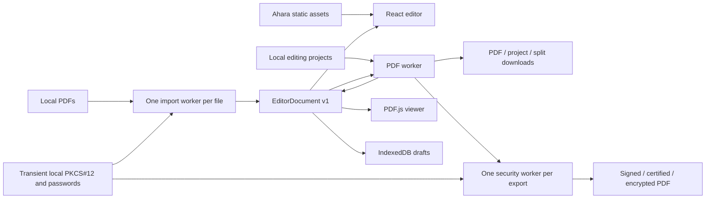

# Architecture

## Runtime boundary

PDFree is a React/TypeScript application built with Vite. Ahara delivers public
application assets at `pdf.ahara.io`; user-selected PDFs, edits, signature images
and signing credentials are processed on the device. Application runtime state
has no server component. Rendering uses PDF.js, writing uses pdf-lib, project ZIP
handling uses fflate, and project validation uses Zod.

The network boundary is defined in [ADR 0001](adr/0001-browser-only-static-delivery.md).
The service worker is registered only after the user opts in from the footer
(`services/offline.ts`), then precaches the full build and owns update prompts;
see [ADR 0010](adr/0010-opt-in-offline-copy.md). The build writes
`offline-manifest.json` with the precache file count and size for the opt-in
panel's size and progress.

The welcome shell keeps session, history, task and draft owners mounted. Editor
views and individual expensive dialogs use module-level React.lazy components
and Suspense. Current drafts do not load PDF
engines, while legacy draft migration loads its source-refresh code on demand.
An error boundary offers a normal browser reload after a view fails to load.
Existing draft saving and browser unsaved-change warnings apply. The
[loading reference](loading.md) describes resource boundaries and measurement;
[ADR 0012](adr/0012-standard-deferred-loading.md) records the decisions.

UI typography uses a WOFF2 representation of the original Noto Sans font with
the same character coverage and metrics. PDF writers retain the original TTF
and existing subsetting. `fontData()` loads both document fonts by default;
internal export consumers request Caveat only when selected objects require it.
Successful font assets are cached across requests. Fonts for other scripts use
the established browser fallback; no external font service is involved.

## Interface messages and languages

`frontend/src/i18n/` owns the canonical English messages, complete catalogs for
16 additional languages, the locale registry and Intl formatting. Pinned
i18next/React bindings update the existing session tree. Non-English catalogs
load as same-origin JavaScript chunks on demand; the opt-in offline package
precaches every chunk. Static HTML and PWA fallback copy come from the English
catalog. The active language updates document language and page metadata at
runtime without changing layout or reading direction.

The preference `pdfree-language-v1` lives in local storage, outside documents,
history, drafts and projects. A valid saved choice precedes ordered browser
preferences and English fallback. Explicit script/region mapping resolves
Chinese and the available Portuguese variant. Loading completes before a
language becomes active, superseded requests cannot replace newer choices,
storage events update other tabs, and storage failures retain the page's choice.

UI state and worker replies carry structured-clone-safe `{ key, values }`
messages. Typed factories require known keys and named interpolation values;
worker boundaries validate exact shapes. Rendering resolves nested messages,
native plurals and locale-formatted numbers/lists. Task kinds, cancellation,
credential retry codes and source diagnostic IDs remain semantic values.
Unknown third-party failures use operation-specific localized messages rather
than displaying arbitrary exception prose. Source warnings and composition
categories store stable IDs; their prose is resolved when shown.

Application defaults become content when created. Existing filenames, PDF text,
fields, comments and bookmarks never change with the UI locale. New dates use
locale order with Gregorian dates and Latin digits, keeping them exportable by
existing PDF fonts. Stamp templates are translated only where those fonts have
the required glyphs; unsupported scripts use explicit `APPROVED` content.
Browser UI font fallback is independent of PDF font embedding. Interface
localization preserves the existing layout and reading direction. PDF export
uses the bundled document fonts and OCR recognizes English.
See [ADR 0011](adr/0011-browser-local-internationalization.md).

## Editing model and coordinates

[`model.ts`](../frontend/src/core/model.ts) defines `EditorDocument.version = 1`:

| Member                | Contract                                                                                                                    |
| --------------------- | --------------------------------------------------------------------------------------------------------------------------- |
| `sources`             | Stable IDs, immutable original PDF bytes, nullable decrypted working bytes/encryption metadata, derived fields and warnings |
| `pages`               | Stable page IDs, source ID/index, rotation, visible box, objects, comments, OCR words, scan adjustments and internal links  |
| `bookmarks` / `rules` | Native outline hierarchy with stable destinations; dynamic numbering, watermarks and stamps scoped to page IDs              |
| `values`              | Native values keyed by source ID and field name, distinct from displayed choice labels                                      |
| `assets`              | Stable asset IDs and local PNG/JPEG bytes referenced by placed objects                                                      |
| `name`                | Validated output/project name                                                                                               |

Page identities survive reorder; source indices address original pages. Blank
pages use an empty source reference. Added content uses PDF page coordinates;
`coordinates.ts` and `widgetGeometry.ts` translate viewport, crop offset and
rotation. `visiblePage.ts` derives the CropBox/MediaBox intersection, with MediaBox
fallback for an empty intersection. Source PDF page boxes remain intact.

`history.ts`, editor operations and React hooks consume this same model. UI
selection and transient dialog state sit outside it. Document replacement resets
clipboard/selection state so assets from another document cannot leak into edits.
Opening and export credentials use separate transient types, never `EditorDocument`.
See [ADR 0002](adr/0002-one-model-immutable-sources.md).

## Import and rendering

`securityClient.ts` runs each PDF import in a dedicated `importWorker.ts` with cancellation
and typed password/recipient retry errors. `unlockPdf.ts` authenticates Standard
password handlers or resolves Adobe.PubSec CMS recipient envelopes before object
streams are read. It creates unprotected working bytes while preserving the
original ciphertext. `sourceBytes()` selects the working copy for viewers/writers.
Passwords and identity files do not become document state.
Recipient cryptography loads only after the strict parser identifies its handler.
Import and secured export share response/credential-erasure handling, while
their entry points remain separate; both terminate after success, failure or
cancellation.

`importPdf.ts` parses working sources and rejects unsupported handlers, XFA, existing
certificate signatures, nonstandard page units and unsupported controls before
editing. It derives field/widget relationships and reports scripted-field and
catalog-composition warnings. `nativeFields.ts` and choice helpers preserve
labels, export values, flags and repeated widgets.

PDF.js renders original or locally prepared scan backgrounds with native fields and added objects
overlaid by the editor. A separate rendering copy omits Text annotation icons;
the shared PDF worker prepares that copy and the comment marker layer supplies
its interactive replacements. Other native
markup appearances remain rendered by PDF.js. Source bytes stay immutable.
Text selection/search use the original text layer, recognized words and
entered text. Page and thumbnail windows bound mounted canvases; raster budgets
bound allocations. Viewers, canvases and temporary object URLs are released as
documents change. [Compatibility](compatibility.md) defines the limits.

## Ordinary PDF and split export

`pdfWorker.ts` accepts typed requests for PDF export, project save/open,
image-page conversion and split export. `workerClient.ts` matches request IDs and
reports startup, transfer or worker failures to the UI. Rendering preparation
and ordinary writing use a shared persistent worker; long cancelable operations
use disposable workers. A crash rejects only requests owned by that worker;
a later request creates its
replacement without a stale crash clearing it.

`exportPdf.ts` selects one of two paths:

- **Preserve:** all pages of one original source, each exactly once. Load its
  bytes, reorder pages, apply rotation/values and remove the catalog OpenAction.
- **Compose:** graft selected pages into a new PDF with `copyForms.ts`.
  Namespace field names across sources, preserve field/widget relationships,
  map edited values and remove orphan widgets. Referenced sources with structures
  that cannot safely be remapped fail explicitly.

Both paths embed bundled fonts, validate text, add authored fields and draw
objects. Native appearances are regenerated. Flattening captures widget
references before pdf-lib removes dictionaries, then removes only those widget
references from page annotations; ordinary comments remain.

`importComments.ts` derives native note/markup text, authors, dates, annotation
indices and same-page reply identities. Each page owns its flat comment records;
stable IDs and parent IDs describe threads. Comments retain the full annotation
rectangle in PDF coordinates so marker bounds match native exports after rotation.
Existing Text notes are editable;
locked/state/group annotations and other markup are read only. Cross-page replies
and their targets are read only and block composition. `comments.ts` applies edits
through the shared history model and assigns fresh thread IDs on page duplication.
`exportComments.ts` updates supported source annotations, removes deleted notes
and their popups, and writes Unicode Text annotations with appearances and IRT/RT
reply links. `copyAnnotations.ts` rebinds page, popup and reply references to the
actual copied annotations before source-index-based edits are applied. Unknown
annotation types remain intact. Form flattening does not flatten comments.

Split preview and output use current physical page membership and stable page
IDs. `exportBatch.ts` processes one split request with reusable parsed sources
and assembles the ZIP in the worker. It does not parse each source anew for each
composed output. PDF pages remain text/vector/image content rather than whole-page
screenshots. See [ADR 0003](adr/0003-pdf-engines-and-preservation.md).

## Secured export

The utility pipeline completes compression and N-up before entering this stage.

The ordinary writer finishes its PDF first. `useExportPdf.ts` establishes
cancellation before credential/font/PDF preparation. `securityClient.ts` then
transfers export bytes and certificate bytes into one dedicated security worker.
That worker terminates after success, failure or cancellation, including transfer
failures. Closing the dialog aborts the operation and prevents a later download.

`securePdf.ts` validates settings and the local identity, creates a signature
placeholder, applies optional AES-256 protection, calculates final byte ranges,
creates detached CMS and inserts it without rewriting covered bytes. LibPDF 0.5.2
handles password protection and signing identity decoding; node-forge 1.4.0
decodes recipient identities and legacy CMS ciphers. `recipientProtection.ts`
builds AES-256 Adobe.PubSec output; `publicKeyPdf.ts`, `recipientKey.ts`,
`recipientEnvelope.ts` and `recipientCipher.ts` authenticate/decrypt incoming
recipient envelopes. PKIjs 3.4.1, ASN1js 3.0.10 and Web Crypto handle
certificate/CMS operations. Encryption precedes signing.

Maintained pnpm patches in `frontend/patches/` fix LibPDF authentication order,
legacy password encoding, strict cipher validation and crypt-filter handling,
and expose explicit public-key cipher hooks. The PKIjs patch corrects the default
RSA-OAEP label and omission of absent ECDH shared-info fields. Independent native
fixtures exercise these corrections. See [ADR 0007](adr/0007-encrypted-document-lifecycle.md).

`signaturePlaceholder.ts` reuses the first empty signature field, rejecting
unsupported seed/lock requirements, or creates an invisible one when none exists.
Generated/widgetless fields combine field and widget
entries, link to the first page and use a zero-size rectangle; existing visible
widgets retain their structure and geometry. Certification adds DocMDP and, for
policy 1, a field lock. [Security](security.md) defines reader semantics and
credential boundaries; [ADR 0005](adr/0005-secured-export-pipeline.md) records rationale.

## Durable projects and local recovery

The `.pdfree` format is a ZIP with `manifest.json`, `sources/<index>.pdf` and
`assets/<index>.png` or `.jpg`. New projects use manifest version 4 with explicit
comments, recognition, scan adjustments, links, bookmarks and repeated rules.
Versions 1–3 remain readable; missing source-derived comments and navigation are
migrated without replacing current saved crop geometry. Encrypted
documents include `working/<index>.pdf` entries and encryption metadata. All
supported manifests decode to editing model version 1. Original
ciphertext remains in `sources/`; working entries are unprotected and contain no
opening credentials. Project save requires explicit confirmation for these documents.
`projects.ts` uses source/asset path descriptors replacing raw bytes. The manifest retains pages,
objects, comments, values and stable IDs; field descriptors are rederived from source PDFs.
`projectSchema.ts`, `projectReferences.ts` and `projectLimits.ts` validate shape,
geometry, unique identities, references and archive budgets on save/open.
Unknown project versions fail explicitly. See [ADR 0004](adr/0004-projects-drafts-and-retained-pwa.md).

IndexedDB stores local library documents under `pdfree-draft-v2:` with write revisions,
model revision 6 and generation tokens. Opening another document creates a separate
entry; reopening a saved document updates its existing entry. Each tab remembers
its active entry for reload recovery. Concurrent saves of the same entry retain
both working copies by assigning a new ID to the conflicting writer.
Legacy drafts refresh derived
source descriptors while retaining edits; revision-2/3 drafts derive missing
comments and normalize nullable source properties without changing saved geometry.
Revision-5 and earlier drafts regenerate source diagnostics from existing
working/original bytes into stable IDs. Migration preserves original ciphertext,
encryption metadata, page identities, saved geometry and user edits. Portable
project formats 1–4 remain readable and unchanged by interface localization.
Current drafts retain explicit comment arrays so deletion survives recovery.
Encrypted-source drafts autosave by default. `services/settings.ts` stores the
browser-wide `pdfree-settings-v1:disable-protected-autosave` preference in local
storage, defaulting false. React subscriptions and native storage events apply
changes to all sessions and browser tabs. The setting stays outside document
history, projects and drafts; old `allowDecryptedDrafts` fields are discarded on
read. Generation and current global preference checks share a
transaction: stale queued writes cannot resurrect deleted entries. Deleting one
entry increments its generation and leaves other entries untouched. BroadcastChannel
and local events notify open tabs of deletion; matching open documents remain in
memory and resume autosaving after the next edit. Remembered signature changes are atomic
IndexedDB updates. Browser storage remains evictable; portable projects provide
the explicit backup path.

## Document utilities and sessions

A cached classifier labels each source page as PDF text, scan, vector graphics
or empty from PDF.js text content and operator lists; OCR planning, the OCR
dialog and the page scan notice share it. OCR renders bounded page images, skips
pages with existing text, keeps earlier recognition unless asked to replace it,
reports a per-page outcome and runs English
recognition in a disposable outer worker owning a Tesseract.js 7 worker. Engine
variants and language data ship as same-origin assets, included in the opt-in
offline copy. Stable-page word boxes
are stored in PDF coordinates and exported as invisible Unicode text. Cancellation
terminates the worker tree; recognition never replaces source content.

Cleanup analysis renders the original page with PDF.js at up to 1,400 pixels per
edge and measures it in `core/scanAnalysis.ts`: projection-profile deskew within
±10°, paper and ink levels from the darkest colour channel, photo and blank
detection, and dark edge bands measured before and after straightening. The live
preview applies the same pixel adjustment and rotation centre as export. The
cleanup worker takes per-page settings and a support check reports which pages
accept image corrections or straightening before anything is applied.

Cleanup stores a processed image asset and crop/deskew parameters, replacing the
page's previous processed asset when no other page uses it. Rendering and
export prepare copies with private image resource dictionaries, keeping other
pages sharing the original image unchanged. Mixed layouts and annotation geometry
that cannot safely follow deskew are rejected. Compression traverses supported
image resources, including nested forms, and keeps the smaller complete output.
Both operations preserve original source bytes.

Supported outlines and internal destinations import into durable records and map
to actual output references on composition. Removed targets prune bookmarks and
clear link actions. Repeated page rules derive their text from current page order;
empty scope means all pages, while explicit scope follows stable IDs. Sequential
multi-file processing retains per-file errors and bounded successful downloads.

N-up embeds cropped/rotated pages as vectors on separate print sheets, baking
supported visible annotation appearances after field flattening. Its output omits
interactive fields, threads and navigation. Compression and N-up run before
signing/encryption; they do not modify the editing document.

Each document session owns history, selection, clipboard, dialogs, tasks and draft
identity. Inactive sessions keep autosave mounted; only the active session mounts
viewers. Session storage remembers saved document IDs and the active ID for reload.
Recovery considers the first 12 stored IDs and restores those with saved drafts;
other saved entries remain in Library.
Encrypted sessions follow the shared browser-wide autosave preference.

Each session also owns a single pinned-page reference through `usePinnedPage.ts`.
It follows a stable page ID and retains split width, floating geometry, zoom/fit,
pan and reading position across document-tab switches. Deletion clears the pin;
undo does not restore view state. This state is separate from the document model,
history, drafts, projects and session-recovery records.

`DocumentWorkspace.tsx` contains both viewers so split resizing and floating
geometry do not resize the surrounding editor chrome. Phones and workspaces
below the usable split width use a native modal dialog. `ReferencePageView.tsx`
reuses the existing canvas/text layers and explicit page/scale inputs to the
field, object, rule and comment layers. Read-only fields use separate radio
group names, and reference keyboard events cannot act on the main selection.
Both viewers use the existing PDF.js source cache, bounded raster allocation
and render cancellation; no exported PDF or page screenshot is needed to build
the reference. Reading positions use page-relative coordinates across zoom,
resizing and presentation changes.

## Source ownership

| Area              | Authoritative sources                                                                                                                        |
| ----------------- | -------------------------------------------------------------------------------------------------------------------------------------------- |
| Model/operations  | `frontend/src/core/model.ts`, `history.ts`, `editorOperations.ts`, `pageOperations.ts`                                                       |
| PDF writer/import | `frontend/src/core/importPdf.ts`, `exportPdf.ts`, `copyForms.ts`, `nativeFields.ts`                                                          |
| Security          | `frontend/src/core/securePdf.ts`, `signaturePlaceholder.ts`, `signatureCms.ts`, `protectPdf.ts`                                              |
| Encrypted input   | `frontend/src/core/unlockPdf.ts`, `publicKeyPdf.ts`, `recipientIdentity.ts`, `recipientEnvelope.ts`, `recipientCipher.ts`, `recipientKey.ts` |
| Persistence       | `frontend/src/core/projects.ts`, `projectSchema.ts`; `frontend/src/services/drafts.ts`, `signatures.ts`                                      |
| UI/orchestration  | `frontend/src/components/`, `frontend/src/hooks/`                                                                                            |
| Worker protocols  | `frontend/src/services/pdfWorker.ts`, `workerClient.ts`, `importWorker.ts`, `credentialWorker.ts`, `securityWorker.ts`, `securityClient.ts`  |
| Localization      | `frontend/src/i18n/`; `frontend/tooling/uiCopyGuard.ts`, `catalogIntegrity.ts`, `catalogHtml.ts`                                             |
| Hosting contract  | `frontend/security-headers.json`, `infrastructure/terraform/`, `platform.yml`, `.github/workflows/ci.yml`                                    |

Deployment ownership and configuration are in [deployment](deployment.md).
